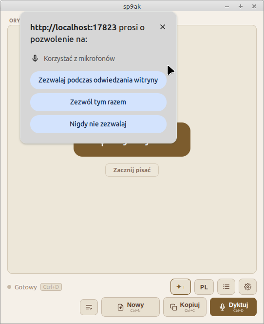

# sp9ak — aplikacja do dyktowania z korektą AI

Lokalna aplikacja webowa do dyktowania głosowego po polsku. Używa Web Speech API do rozpoznawania mowy oraz **Gemini Nano** (lokalny model AI wbudowany w Chrome Beta) do automatycznej korekty interpunkcji — wszystko działa offline, bez wysyłania danych do chmury.

---

## Wymagania systemowe

- Linux 64-bit (Debian / Ubuntu lub kompatybilna dystrybucja)
- Python 3.6+
- Google Chrome Beta 149+
- Mikrofon

---

## Krok 1 — Instalacja Chrome Beta

1. Otwórz terminal i pobierz pakiet `.deb`:
   ```bash
   wget -O /tmp/chrome-beta.deb "https://dl.google.com/linux/direct/google-chrome-beta_current_amd64.deb"
   ```

2. Zainstaluj:
   ```bash
   sudo dpkg -i /tmp/chrome-beta.deb
   sudo apt-get install -f   # naprawia brakujące zależności jeśli potrzeba
   ```

3. Sprawdź wersję (wymagana 149+):
   ```bash
   google-chrome-beta --version
   ```

---

## Krok 2 — Włączenie Gemini Nano w Chrome Beta

Wykonaj poniższe kroki w **Chrome Beta** (nie w zwykłym Chrome).

### 2a. Włącz Prompt API

1. Otwórz nową kartę i wklej w pasek adresu:
   ```
   chrome://flags/#prompt-api-for-gemini-nano
   ```
2. Zmień wartość z `Default` na **`Enabled`**

### 2b. Włącz pobieranie modelu z obejściem wymagań sprzętowych

1. Wklej w pasek adresu:
   ```
   chrome://flags/#optimization-guide-on-device-model
   ```
2. Zmień wartość na **`Enabled BypassPerfRequirement`**
   > Ważne: wybierz `BypassPerfRequirement`, nie zwykłe `Enabled` — ta opcja omija sprawdzanie wymagań sprzętowych, niezbędna na większości konfiguracji Linux.

### 2c. Uruchom ponownie Chrome Beta

Po ustawieniu obu flag kliknij przycisk **Uruchom ponownie** na dole strony flags, a następnie dla pewności zamknij też przez terminal:

```bash
killall -9 google-chrome-beta
```

---

## Krok 3 — Pierwsze uruchomienie i pobranie modelu

Model Gemini Nano (~4 GB) musi zostać pobrany raz. Pobieranie odbywa się przez konsolę DevTools w Chrome Beta.

1. Otwórz Chrome Beta i przejdź na dowolną stronę (np. `chrome://newtab`)

2. Otwórz DevTools: klawisz **F12**, zakładka **Console**

3. Sprawdź dostępność modelu:
   ```js
   await LanguageModel.availability()
   ```
   Oczekiwana odpowiedź: `'downloadable'` lub `'available'`

   Jeśli wynik to `'unavailable'` — wróć do kroku 2 i upewnij się, że obie flagi są ustawione poprawnie.

4. Jeśli wynik to `'downloadable'` — uruchom pobieranie (nie zamykaj DevTools ani karty podczas pobierania):
   ```js
   const session = await LanguageModel.create({
     monitor(m) {
       m.addEventListener('downloadprogress', e => {
         console.log(Math.round(e.loaded / 1048576) + ' MB pobrano');
       });
     }
   });
   ```
   W konsoli będą pojawiać się kolejne liczby (megabajty). Pobieranie zajmuje kilka–kilkanaście minut zależnie od łącza.

5. Po zakończeniu pobierania przetestuj model:
   ```js
   const s = await LanguageModel.create()
   await s.prompt("Napisz jedno zdanie po polsku")
   ```
   Model powinien odpowiedzieć zdaniem po polsku. Jeśli tak — gotowe.

---

## Krok 4 — Uruchomienie aplikacji

1. Przejdź do katalogu projektu:
   ```bash
   cd /ścieżka/do/projektu
   ```

2. Nadaj uprawnienia wykonywania (tylko przy pierwszym uruchomieniu):
   ```bash
   chmod +x sp9ak.sh
   ```

3. Uruchom:
   ```bash
   ./sp9ak.sh
   ```

Skrypt automatycznie:
- sprawdza czy Python 3 i Chrome Beta są zainstalowane
- uruchamia lokalny serwer HTTP na porcie 17823
- otwiera aplikację w oknie Chrome Beta z izolowanym profilem
- po zamknięciu okna zatrzymuje serwer

### Zgoda na mikrofon

Przy pierwszym uruchomieniu (a także po usunięciu katalogu `chrome-profile`) Chrome zapyta o dostęp do mikrofonu:



Wybierz **Zezwalaj podczas odwiedzania witryny** — zgoda zostanie zapamiętana w profilu aplikacji i pytanie nie pojawi się ponownie. Opcja „Zezwól tym razem" wymusza ponowne pytanie przy każdym uruchomieniu, a „Nigdy nie zezwalaj" całkowicie blokuje dyktowanie.

Jeśli odmówiono zgody przez pomyłkę, zobacz [Rozwiązywanie problemów](#dyktowanie-nie-działa-mikrofon-zablokowany).

---

## Krok 5 — Weryfikacja działania AI w aplikacji

Po uruchomieniu aplikacja wykonuje automatyczny test Gemini Nano. Obserwuj wskaźnik **✦** w górnym pasku:

| Stan wskaźnika | Znaczenie |
|---|---|
| ✦ **AI** (zielony) | Gemini Nano aktywny — korekta AI działa |
| ✦ **↓** (żółty) | Model jest pobierany — poczekaj kilka minut |
| ✦ **⚠** (czerwony) | Błąd — sprawdź logi |

Aby zobaczyć szczegółowe logi diagnostyczne: kliknij ikonę **☰** (ustawienia) → **Pokaż logi**.

### Co powinno pojawić się w logach przy poprawnym działaniu:

```
[INFO] availability() po normalizacji: "available"
[INFO] Tworzę sesję AI…
[INFO] Testuję model (prompt testowy)…
[OK]   Test OK – odpowiedź: "OK."
```

---

## Rozwiązywanie problemów

### `availability()` zwraca `'unavailable'`
- Upewnij się, że używasz Chrome Beta 149+ (nie Chrome Stable)
- Sprawdź czy obie flagi z kroku 2 są ustawione
- Zamknij Chrome Beta przez `killall -9 google-chrome-beta` i uruchom ponownie

### Aplikacja czeka długo z komunikatem "Inicjalizacja modelu…"
Przy pierwszym uruchomieniu z nowym profilem Chrome rejestruje model — to normalne i trwa do kilku minut. Poczekaj, aż wskaźnik ✦ zmieni kolor na zielony.

### Dyktowanie nie działa (mikrofon zablokowany)
Prawdopodobnie wybrano „Nigdy nie zezwalaj" w oknie z prośbą o dostęp do mikrofonu. Okno aplikacji nie ma paska adresu, więc ustawienie zmienisz tak:
1. Zamknij okno sp9ak.
2. Otwórz Chrome Beta z profilem aplikacji i wejdź na `chrome://settings/content/microphone`:
   ```bash
   google-chrome-beta --user-data-dir="$PWD/chrome-profile" chrome://settings/content/microphone
   ```
3. Usuń `http://localhost:17823` z listy zablokowanych (lub zmień na „Zezwalaj"), zamknij Chrome i uruchom `./sp9ak.sh`.

Alternatywnie usuń katalog `chrome-profile` — przy następnym starcie pytanie pojawi się ponownie (model Gemini Nano zostanie wtedy zarejestrowany od nowa, patrz niżej).

### Błąd "port 17823 jest zajęty"
Inny proces używa portu. Sprawdź i zakończ go:
```bash
ss -ltnp | grep 17823
```

### Błąd "google-chrome-beta nie jest zainstalowany"
Wróć do kroku 1 i zainstaluj Chrome Beta.

### ✦ pokazuje ⚠ mimo że model był pobierany
```bash
killall -9 google-chrome-beta
./sp9ak.sh
```

---

## Testy AI (Gemini Nano)

Plik `web/nano-check/cases.js` zawiera 30 przypadków testowych — pary (oryginalny tekst STT → oczekiwana korekta). Strona `web/nano-check/index.html` uruchamia je kolejno przez Gemini Nano i pokazuje, które przypadki AI obsłużył poprawnie.

### Uruchomienie testów

```bash
./sp9ak.sh --test
```

Skrypt uruchamia serwer i otwiera stronę `nano-check` zamiast aplikacji głównej. Wymagania są identyczne jak dla aplikacji (Chrome Beta z aktywnym Gemini Nano — kroki 1–3 powyżej).

Można też otworzyć testy w już działającej aplikacji: wejdź w Chrome na `http://localhost:17823/nano-check/`.

### Jak działają testy

Po otwarciu strona:
1. Sprawdza dostępność Gemini Nano (`LanguageModel.availability()`).
2. Tworzy sesję z promptem korekty tekstu (`CORRECTION_SYSTEM_PROMPT` z `web/js/prompts.js`).
3. Po kliknięciu **▶ Uruchom testy** wysyła każdy przypadek testowy do modelu i porównuje wynik z oczekiwanym tekstem.

### Interpretacja wyników

| Kolor wiersza | Znaczenie |
|---|---|
| Zielony | AI zwróciło dokładnie oczekiwany tekst |
| Czerwony | Różnica — widoczny diff (czerwone = błąd w wyniku AI, zielone = co AI zwróciło zamiast) |

Przyciski filtrów pozwalają wyświetlić tylko błędy lub tylko zaliczone przypadki. Log na dole strony pokazuje szczegóły każdego wywołania.

---

## Struktura projektu

```
.
├── web/                  # frontend serwowany przez lokalny serwer (bez bundlera, moduły ES)
│   ├── index.html
│   ├── css/              # motywy, układ, kontrolki, panele, modal
│   ├── js/
│   │   ├── main.js       # składa aplikację z poniższych modułów
│   │   ├── core/         # czysta logika bez DOM: interpunkcja (punctuation/: pl.js, en.js, shared.js), odcinek mowy, parsowanie korekty, definicje sygnałów dźwiękowych…
│   │   ├── services/     # dyktowanie, Gemini Nano, zewnętrzne AI, historia sesji, skrót globalny, odtwarzacz dźwięków
│   │   └── ui/           # cienkie widoki DOM (panele, historia, przyciski, przebieg audio…)
│   └── nano-check/       # strona do ręcznego sprawdzenia jakości korekty Gemini Nano
├── server/               # serwer HTTP: pliki statyczne, /api/sessions, /api/ai (proxy), /api/hotkey
├── desktop/              # integracja z pulpitem X11: ikona w trayu, pozycja okna, skrót globalny
├── scripts/              # skrypty instalacyjne (skrót w menu i na pulpicie)
├── tests/
│   ├── unit/             # vitest (jsdom): core, services, ui
│   ├── python/           # unittest: serwer, dostawcy AI, X11, skrót
│   └── e2e/              # Playwright + prawdziwy Chrome: scenariusze użytkownika, tryb offline, monkey test
├── sp9ak.sh              # launcher (serwer + tray + okno Chrome)
└── sessions.json         # zapisane sesje dyktowania (tworzony automatycznie, poza gitem)
```

---

## Rozwój i testy

```bash
npm install
npm test                  # testy jednostkowe JS (vitest + jsdom)
npm run coverage          # j.w. z raportem pokrycia
npm run test:py           # testy Pythona
npm run test:e2e          # scenariusze w prawdziwym Chrome (wymaga /usr/bin/google-chrome lub CHROME_PATH)
npm run test:monkey       # losowe klikanie (gremlins.js); GREMLINS_SEEDS="1,2" GREMLINS_ACTIONS=2000
npm run test:layout       # losowe klikanie w kilku rozmiarach okna + kontrola układu (gremlins.js)
npm run test:a11y         # pa11y (WCAG 2 AA, axe + HTML_CodeSniffer) w trzech motywach i kilku stanach okna
npm run test:lighthouse   # Lighthouse (desktop): wydajność, dostępność, dobre praktyki, SEO; progi LH_MIN_PERFORMANCE itd.
npm run test:quality      # oba powyższe
npm run lint              # eslint + ruff (ruff w venv, patrz CONTRIBUTING.md#środowisko)
npm run test:all          # wszystko powyżej poza lintem
```

Testy E2E używają atrapy `SpeechRecognition` i atrapy `/api/ai`, więc nie potrzebują mikrofonu, internetu ani kluczy API.
Serwer w testach zapisuje historię do pliku tymczasowego (`SP9AK_SESSIONS`), nie do prawdziwego `sessions.json`.

Zależności Pythona (`gi`, `python-xlib`) są potrzebne tylko do ikony w trayu i skrótu globalnego. Pozostały kod używa wyłącznie biblioteki standardowej.

### Gałęzie i wydania

Cała praca trafia pull requestami do `dev`. Stabilne wydanie powstaje dopiero z `dev`:

```
feature/*, fix/*, docs/*  →  dev  →  release/YYYY-MM-DD  →  main (tag vYYYY.MM.DD)
```

Na `release/YYYY-MM-DD` są tylko poprawki stabilizujące i pełne testy (`lint`, `test`, `test:py`, `test:e2e`, `test:monkey`, `packaging/build-deb.sh`). Wersje próbne mają tag `vYYYY.MM.DD-rc.N`. Szczegóły dla współautorów i agentów AI: [AGENTS.md](AGENTS.md#wydania).

---

## Skrót w menu i na pulpicie (bez pakietu)

Dla sklonowanego repo wystarczy jedno polecenie, bez `sudo` i bez `.deb`:

```bash
scripts/install-shortcut.sh             # skrót w menu aplikacji (wyszukiwarka programów)
scripts/install-shortcut.sh --desktop   # dodatkowo ikona na pulpicie
scripts/install-shortcut.sh --uninstall # usuwa oba
```

Skrót wskazuje na `sp9ak.sh` w katalogu projektu, więc po przeniesieniu repo uruchom skrypt ponownie. Ponowne kliknięcie skrótu przy działającej aplikacji tylko wysuwa jej okno (nie restartuje serwera). W katalogu `scripts/` trzymamy tego typu skrypty instalacyjne.

## Instalacja w systemie (pakiet .deb)

To dodatkowa, opcjonalna możliwość. Aplikację nadal można po prostu sklonować i uruchomić przez `./sp9ak.sh` (Krok 4), bez instalowania czegokolwiek w systemie; wtedy profil i historia zostają w katalogu projektu. Pakiet jest dla osób, które wolą uruchamiać aplikację z menu systemowego zamiast z terminala.

```bash
packaging/build-deb.sh            # tworzy dist/sp9ak_1.0.0_all.deb
sudo apt install ./dist/sp9ak_1.0.0_all.deb
```

Aplikacja pojawi się w menu systemowym w kategorii **Biuro** (polecenie `sp9ak`). Chrome Beta (kroki 1–3) instaluje się osobno. Profil Chrome i historia sesji są w `~/.local/share/sp9ak`. Usunięcie: `sudo apt remove sp9ak`.

## WIELKIE LITERY dla głośniejszych fraz

Chip **Aa** na dolnym pasku (domyślnie wyłączony) włącza analizę głośności głosu. Aplikacja uczy się Twojego zwykłego poziomu (po kilku pierwszych frazach), a fraza wypowiedziana wyraźnie głośniej (ok. 1,5× średniej) zostanie zapisana wielkimi literami. Rozpoznawanie działa na całych frazach, nie na pojedynczych słowach.

## Sygnały dźwiękowe

Aplikacja odpowiada krótkimi, cichymi sygnałami generowanymi w przeglądarce (Web Audio API, bez plików dźwiękowych). Domyślnie są włączone. Wyłączysz je w **Motyw i ustawienia** → **Dźwięki**.

| Akcja | Sygnał |
|---|---|
| Start dyktowania (mikrofon już słucha) | dwa tony w górę |
| Koniec dyktowania | dwa tony w dół |
| Dyktowanie przerwane błędem, błąd AI, nieudany test klucza | dwa niskie tony |
| Skopiowano, klucz działa, korekta bez uwag, zastosowano korektę, połączenie wróciło | jasny dwudźwięk w górę |
| Korekta semantyczna znalazła podejrzane słowa | pojedynczy ton |
| Brak internetu | dwa tony w dół, ciszej |
| Nowa notatka | krótkie arpeggio w górę |
| Usunięcie sesji, czyszczenie historii lub logów, usunięcie klucza | dwa niskie tony w dół |
| Włączenie / wyłączenie opcji (✦, Aa, przypięcie, logi, sugestia) | wyższe / niższe tyknięcie |
| Wybór (motyw, język, sesja z historii, dostawca AI) | ciche tyknięcie |
| Otwarcie / zamknięcie panelu | bardzo ciche tony w górę / w dół |

Gdy jedna akcja zmienia kilka rzeczy naraz (np. otwarcie panelu zamyka inny), gra tylko najważniejszy sygnał. `sp9ak.sh` uruchamia Chrome z `--autoplay-policy=no-user-gesture-required`, żeby sygnał zabrzmiał także przy starcie dyktowania globalnym skrótem, zanim klikniesz w okno.

## Globalny skrót systemowy (X11)

Ikona w trayu nasłuchuje globalnego skrótu **Ctrl+F11** (działa nawet gdy okno jest schowane lub na innym pulpicie):
pokazuje okno sp9ak i włącza dyktowanie (jeśli już trwa, nic nie zmienia). **Ctrl+Shift+F11** kończy dyktowanie, jeśli trwa (inaczej nic nie robi). Wymaga `python3-xlib`, `wmctrl`, `xdotool`.

Inne skróty: `SP9AK_HOTKEY="ctrl+alt+d" SP9AK_HOTKEY_STOP="ctrl+alt+s" ./sp9ak.sh`. Jeśli skrót jest zajęty przez inną aplikację, tray działa dalej bez skrótu.
Na Waylandzie globalne skróty nie są dostępne dla zwykłych programów – ustaw wtedy skrót w ustawieniach systemu.

## Pasek przycisków okna (X11)

Nad edytorem jest maleńki pasek z przyciskami okna. Pierwszy z nich, pinezka, przypina okno na wierzchu (Always On Top)
i zdejmuje to przypięcie. Pasek korzysta z `wmctrl`; gdy go brak albo na Waylandzie, przycisk jest ukryty.

## Grubsza karetka

Chrome rysuje karetkę w polu tekstowym o szerokości 1 px i CSS nie pozwala jej pogrubić, więc w polu „Oryginał”
łatwo ją zgubić. Aplikacja ukrywa karetkę przeglądarki i rysuje własną, szerszą (2 px, w kolorze motywu), która miga
tak jak zwykła. Znika przy zaznaczeniu tekstu i gdy pole traci fokus (`web/js/ui/thick-caret.js`).

## Interpunkcja według języka

Automatyczna interpunkcja (chip ✦) działa regułami, osobnymi dla każdego języka rozpoznawania (PL / EN):
`web/js/core/punctuation/pl.js` i `en.js` zawierają listy słów, a `shared.js` wspólne przebiegi. Reguły:

- **przecinek** przed spójnikami i zdaniami podrzędnymi oraz po zwrotach wprowadzających na początku zdania,
- **średnik** przed „jednak", „natomiast", „ponadto" (EN: „however", „moreover"…) po dłuższym zdaniu (od 6 słów); krótkie zdanie zostaje z przecinkiem,
- **pauza** przed „czyli", „to znaczy" (PL: ` – `; EN: „that is", „namely": `—`),
- **wyliczenia**: po „takie jak", „na przykład" (EN: „such as", „including") ciąg co najmniej trzech pojedynczych słów zakończony „i" / „oraz" / „and" dostaje przecinki,
- znak końca zdania (pytajnik, gdy zdanie zaczyna się jak pytanie) i wielkie litery.

Nieznany język używa reguł polskich. Nowy język to nowy plik z regułami i wpis w `index.js`.

## Praca bez internetu / przy słabym łączu

- Aplikacja, interpunkcja (regex), historia i lokalny Gemini Nano działają bez internetu.
- Rozpoznawanie mowy w Chrome korzysta z chmury: przy błędzie sieci dyktowanie jest ponawiane (1 s, 2 s, 4 s), a potem łagodnie przerywane z zachowaniem tekstu.
- Zewnętrzne AI (Claude/OpenAI): limit czasu żądania, czytelne komunikaty, automatyczny powrót po odzyskaniu sieci i awaryjne przełączenie na Gemini Nano.
- Historia sesji ma kopię w `localStorage`, gdy serwer jest niedostępny.

## Licencja

MIT, Copyright (c) 2026 desi9n.pl. Szczegóły w pliku [LICENSE](LICENSE).

Jeśli tworzysz fork lub pochodną wersję projektu, musisz zachować informację o autorstwie **desi9n.pl** (nota o prawach autorskich i treść licencji MIT z pliku [LICENSE](LICENSE)) oraz wskazać oryginalne repozytorium. Zmiany w repozytorium przyjmujemy wyłącznie od zespołu; pull requesty i zgłoszenia od osób z zewnątrz są wyłączone.
